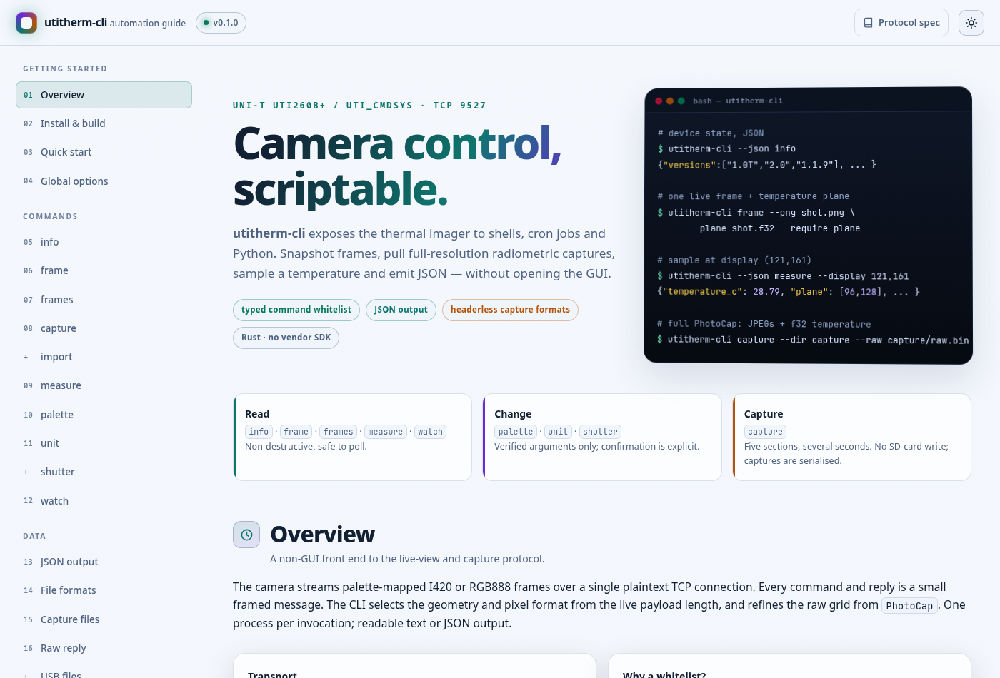
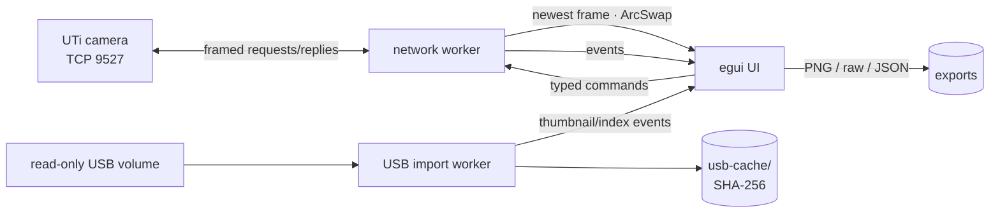

# utitherm

### Independent Rust + egui client and CLI for UNI-T `UTi_cmdsys` thermal imagers

<p align="center">
  
</p>

<p align="center">
  <a href="#quick-start"></a>
  <a href="#testing"></a>
  <a href="UTi-family-protocol-spec.md"></a>
  <a href="LICENSE-MIT"></a>
</p>

<p align="center">
  <strong>Live thermal video · radiometric measurement · full-resolution capture · read-only USB import</strong><br>
  Clean-room implementation. No vendor SDK, no linked vendor code, no fixed camera IP.
</p>

---

## Why utitherm

| | |
|---|---|
| **Live view** | Palette-mapped I420/RGB888 over TCP 9527, integer-scaled egui rendering, FPS/RTT/drop counters |
| **Measurement** | Geometry-driven display → raw-plane mapping; pixel sampling, capture statistics, CSV/JSON-ready output |
| **Capture** | `PhotoCap` JPEGs, f32 temperature plane, u16 diagnostics plane, raw reply export |
| **USB import** | Read-only scan, container validation, SHA-256 dedupe, metadata, thumbnails, offline measurement |
| **FFC** | Shutter/FFC request, boundary detection and measurement re-baselining |
| **Automation** | Typed-command CLI with stable JSON, offline capture/plane/USB inputs |
| **Family** | Length-selected geometry and pixel format for Tier 1/2 `UTi_cmdsys` models |

## Screenshots

<p align="center">
  
</p>

<p align="center"><sub><strong>Live view on a real UTi260B+</strong> — thermal image with burned-in OSD, key temperatures, 192×256 measurement plane, USB import panel and device state. Captured at ~18 fps on firmware 1.1.9.</sub></p>

<p align="center">
  
</p>

<p align="center"><sub><strong>CLI guide</strong> — self-contained HTML reference for commands, JSON schemas, capture formats and the plane mapping. Open <a href="docs/cli.html"><code>docs/cli.html</code></a>.</sub></p>

## Supported models

**Hardware-verified:** `UTi260B+` (DEV_TYPE 112, firmware 1.1.9).

The live parser selects display size, raw size, pixel format and optional tail from the message length. `PhotoCap` then refines the raw grid from section 1 and the JPEG headers. This covers the documented Tier 1/2 geometries:

<table>
  <thead>
    <tr><th>Tier</th><th>Models</th><th>Live pixels</th><th>Status</th></tr>
  </thead>
  <tbody>
    <tr><td>1</td><td>UTi720B</td><td>I420</td><td>Geometry identical to reference</td></tr>
    <tr><td>1</td><td>UTi165B+, UTi716B, UTi320V+, UTi260V</td><td>RGB888</td><td>Inferred, not hardware-tested</td></tr>
    <tr><td>2</td><td>UTi320E, UTi260E, UTi384H, UTi384H JX003, UTi740H</td><td>RGB888</td><td>Inferred; UTi384H port 9527/9528</td></tr>
    <tr><td>2</td><td>UTi260T, UTi720T</td><td>RGB888</td><td>Inferred; optional sixth PhotoCap section</td></tr>
    <tr><td>2</td><td>UTi720E/730E, UTi720V/730V</td><td>RGB888</td><td>Inferred E/V-family geometry</td></tr>
  </tbody>
</table>

> **Validation caveat:** only the UTi260B+ has been exercised end to end. Tier 1/2 entries are derived from vendor-client analysis in [`UTi-family-protocol-spec.md`](UTi-family-protocol-spec.md). A 640×480 RGB888 base frame cannot identify its raw grid until a plane or `PhotoCap` arrives. USB import remains specific to the reference 192×256 container.

Out of scope: UTi640Q (RTSP 8086/8087), UTi384G/UTi256G (Guide SDK HTTP 23021 + RTSP 8554).

## Quick start

```sh
git clone https://github.com/hansfbaier/utitherm.git
cd utitherm

cargo build --release
./target/release/utitherm-viewer          # GUI, camera IP from default gateway
./target/release/utitherm-viewer --ip 192.168.27.10

./target/release/utitherm-cli info
./target/release/utitherm-cli --json frame --png frame.png --plane frame.f32
./target/release/utitherm-cli measure --display 121,161
```

Join the camera's Wi-Fi AP first, or pass `--ip`. `--ip auto` (default) resolves the host default gateway of the camera AP. Press **Space** to connect/disconnect when no text field has focus.

## GUI

- Single live texture with integer scaling for crisp burned-in OSD.
- Key temperatures converted from wire Celsius using the `init` unit bit field.
- `PhotoCap` section viewer: JPEGs, f32 temperature plane, u16 raw plane, tail and export.
- FFC `Shutter` button; automatic key-temperature step detection clears the live measurement baseline for two frames.
- USB gallery with thumbnails and plane selection.
- Measurement crosshair with display and raw coordinates.
- Export PNG plus `.yuv` (I420) or `.rgb` (RGB888).
- Dark egui UI, no external runtime assets.

## CLI

`utitherm-cli` exposes the same worker and typed whitelist as the GUI. One process per invocation; stable JSON with `--json`.

```sh
# device state
utitherm-cli --json info

# live frame + optional temperature plane
utitherm-cli frame --png shot.png --yuv shot.yuv --plane shot.f32 --require-plane

# sample the live plane
utitherm-cli --json measure --display 121,161

# full-resolution capture
utitherm-cli capture --dir capture --raw capture/raw.bin

# offline measurement
utitherm-cli measure --capture-file capture/raw.bin --plane 96,128
utitherm-cli measure --temp-file capture/temperature.f32 --display 121,161
utitherm-cli measure --usb-file /media/UTi/DCIM/202610240001E.jpg --display 121,161

# read-only USB import + gallery index
utitherm-cli import --path /run/media/$USER/585A980C530F08BD --cache usb-cache
utitherm-cli --json import --cache usb-cache --list

# controls
utitherm-cli palette 3
utitherm-cli unit celsius
utitherm-cli shutter
utitherm-cli --json watch --frames 100 --sample 121,161
```

Full command reference, JSON schemas and file formats: [`docs/cli.html`](docs/cli.html).

## Measurement and capture

`PhotoCap` sections are length-prefixed and parsed dynamically:

| # | Content | Geometry |
|---|---|---|
| 0 | JPEG with OSD | display size |
| 1 | f32 LE °C temperature plane | `raw_w × raw_h` |
| 2 | Clean/visible JPEG | larger display size |
| 3 | u16 LE raw sensor plane | `raw_w × raw_h` |
| 4 | Optional trailing/TM block | model-dependent |
| 5 | Optional `meterInfo` extension | T-family only |

The plane maps to the display with no rotation or flip at `raw_w/display_w` and `raw_h/display_h` (1.25 on the UTi260B+). Section lengths, not the reference sizes, are authoritative.

`PhotoCap` is serialised client-side. A 17-byte empty `{UTi_Photo}` reply is the sticky capture-unavailable latch: capture is disabled while the live stream continues; restart the camera application before retrying. Never open a second connection or send another request during a capture.

## USB import

The camera volume is treated as **strictly read-only**:

- detect volumes by `AUTORUN.INF` marker plus `DCIM/`
- validate container size, both length words, JPEG bounds and physical temperature range
- copy into a host cache keyed by SHA-256
- preserve firmware, model, emissivity, distance, humidity, ambient and unit
- generate thumbnails on the import worker
- support dual-JPEG and thermal-only (`len2 = -1`) containers

The volume must already be mounted; the client never mounts, writes, renames, deletes or repairs anything on it.

## Architecture



```text
net worker      framing, reconnect, command queue, I420/RGB888 → RGBA,
                PhotoCap parsing, pacing, HeartBack, capture latch
usb worker      scan, validate, copy, hash, index, thumbnails
ui thread       events, textures, measurement, controls
cli             same worker + typed commands; JSON and file writers
```

Framing errors drop the connection and re-run `init`; the stream is never resynchronised by token scanning. Exactly one `vFrame` request is outstanding; frames are not queued.

## Safety

The device daemon exits on malformed command arguments and needs a power cycle. Therefore:

- every command is built from a typed enum, never interpolated text;
- only verified argument forms are exposed;
- `PhotoCap` is serialised and never retried after the sticky unavailable reply;
- no second connection or request is sent during a capture;
- USB import never writes to the camera volume.

Device-default access notes and platform details are in [`DEVICE-PROFILE.md`](DEVICE-PROFILE.md). The client itself requires no account or credential.

## Configuration

`./utitherm.toml` or `~/.config/utitherm/config.toml`:

```toml
[camera]
ip = "auto"
live_port = 9527
connect_timeout_ms = 2000
read_timeout_ms = 2000
target_fps = 20
out_dir = "captures"

[usb]
marker = "UNIT UTi260B+"
```

Old `uti260b.toml` paths are accepted as fallbacks. CLI flags override the file. `--usb-marker` overrides the volume marker per invocation.

## Testing

```sh
cargo test
cargo fmt --check
cargo clippy --all-targets
```

The suite covers framing rejection, init offsets, unit/colour-scale decoding, FFC detection, family length/geometry selection, RGB888 conversion, dynamic `PhotoCap` geometry, capture latch, USB container variants, import worker, replay and CLI helpers. **82 tests.**

`--replay` accepts framed fixtures or raw `.yuv` blocks; `--make-fixtures DIR` writes a synthetic set.

## Documentation

| Document | Contents |
|---|---|
| [`docs/cli.html`](docs/cli.html) | CLI reference, JSON, capture/USB formats, recipes |
| [`UTi260B-plus-protocol-spec.md`](UTi260B-plus-protocol-spec.md) | Reference-model protocol |
| [`UTi-family-protocol-spec.md`](UTi-family-protocol-spec.md) | Tier 1/2 family protocol and geometry |
| [`DEVICE-PROFILE.md`](DEVICE-PROFILE.md) | Reference unit platform/access notes |

## License

MIT OR Apache-2.0.

---

<p align="center"><sub>Independent project. UNI-T and UTi are trademarks of their respective owners; this project is not affiliated with or endorsed by UNI-T.</sub></p>
