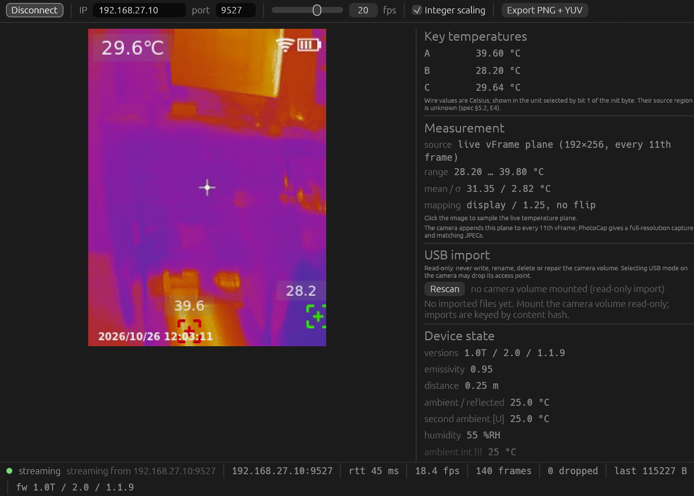

# uti260b-viewer

Independent Rust client for the UNI-T **UTi260B+** thermal imager — egui GUI
plus an automation CLI — implemented from
[`UTi260B-plus-protocol-spec.md`](UTi260B-plus-protocol-spec.md).
No vendor code or libraries are used. The client needs no account or credential;
the device-default access notes are documented separately in
[`DEVICE-PROFILE.md`](DEVICE-PROFILE.md).



*Live view over TCP 9527: palette-mapped thermal image, key temperatures, the
192×256 measurement plane, USB import panel and device state. The screenshot
was captured from a real UTi260B+ on firmware 1.1.9 at ~18 fps.*

Related documents: [`UTi-family-protocol-spec.md`](UTi-family-protocol-spec.md)
generalises the same protocol to the other `UTi_cmdsys` models (UTi720B, UTi165B+,
UTi716B, UTi320V+, UTi260V and the E/V/H/T tiers), and
[`DEVICE-PROFILE.md`](DEVICE-PROFILE.md) records the platform, access and
calibration layout of the reference unit.

**CLI documentation:** open [`docs/cli.html`](docs/cli.html) in a browser for the
full command reference, JSON schemas and capture file formats.

Scope is the TCP 9527 protocol — `init`, the live `vFrame` stream, `PhotoCap` and
its 192×256 f32 temperature plane — plus read-only import of the camera's USB
radiometric files (spec §11). Commands are a typed whitelist because malformed
arguments kill the device daemon and require a power cycle (spec §3).

## Build and run

```sh
cargo build --release                       # GUI + CLI binaries
cargo run --release --bin uti260b-viewer    # live mode, IP from default gateway
cargo run --release --bin uti260b-viewer -- --ip 192.168.27.10
cargo run --release --bin uti260b-cli -- info
cargo run --release --bin uti260b-cli -- import --path /run/media/$USER/585A980C530F08BD
```

Join the camera's Wi-Fi AP (`UTi260B+`) first, then press **Connect**.
`--ip auto` (the default) reads the host default gateway — while joined to the
camera AP the camera is the gateway.

Space toggles connecting when a text field does not have focus.

## What the UI does

- Streams frames into a single `TextureHandle`, default integer scaling computed
  in physical pixels so the burned-in OSD stays crisp at fractional DPI;
  nearest-neighbour filtering at integer scale, linear for fractional fit.
  Aspect ratio 3:4.
- Shows the three per-frame header temperatures as unlabelled readings,
  converted from wire Celsius to the unit selected by bit 1 of the `init` byte.
  They are **not** max/min/centre of the measurement plane (spec §5.2, E4).
- Accepts both live-frame payloads: the base 115 212-byte reply and the extended
  311 820-byte reply carrying a 192×256 f32 temperature plane. This firmware
  appends the plane to every 11th frame (~0.6 s at 20 fps).
- Shows the full `init` state, marking inferred `[I]` and unknown `[U]` fields,
  and surfaces unit changes as confirmed only after re-reading `init`.
- **PhotoCap** button (user-initiated, several seconds, no file is written on the
  camera: verified by listing the SD volume before and after) fetches a
  full-resolution capture and shows its statistics, section sizes and the 192×256
  geometry. Live frames also carry a lower-rate temperature plane — every 11th
  frame, per spec §5.
- **USB import** scans mounted camera volumes read-only, copies and validates
  radiometric files on a dedicated worker, indexes them by SHA-256 and shows a
  thumbnail gallery. Selecting an entry uses its plane for measurement. The
  camera volume is never written, renamed or repaired. Import scanning pauses
  while a live network session is active (spec §11.6).
- Clicking the image samples the selected USB plane or capture first, then the
  most recent live plane, through the documented mapping
  `plane = display / 1.25` (no rotation, no flip); it draws a small crosshair
  and shows the temperature in °C.
- Palette changes (`colorChange+0..7`) are confirmed against following frames
  using the reference mean-RGB/saturation signatures; a mismatch is surfaced
  instead of silently accepted.
- Status bar: connection state, RTT, achieved fps, frame count, frames dropped
  because the UI did not paint them, stale-frame age, and the three version
  strings.
- **Export PNG + YUV** writes the current live frame to `./captures/`.
  The capture panel exports the temperature plane (f32 LE °C) and the raw u16
  plane.

## Architecture

```text
[ net worker thread ]  blocking TcpStream, session state machine, reconnect backoff
                       write command → read token/length/payload/CRLF → validate
                       YUV→RGBA and PhotoCap decoding → ArcSwap / event stream
[ usb worker thread ]  read-only volume scan, validate/copy/hash/index, thumbnails
                       progress and imported records → channel
[ UI thread ]          drain events, take newest frame, upload texture, paint
```

- Framing errors (wrong token, length mismatch, missing CRLF, bad payload size)
  drop the connection and re-run `init`; the stream is never resynchronised by
  scanning (spec §7).
- No frame queue: `ArcSwap` overwrites unpainted frames. The UI reports the gap
  as dropped frames.
- Conversion and capture parsing run on the worker thread; the UI callback never
  touches the planes.
- Socket timeouts (2 s default), `TCP_NODELAY` and `SO_KEEPALIVE` are set.
  `PhotoCap` temporarily raises the read timeout to 30 s because a capture can
  take several seconds (spec §6). Captures are serialised. A 17-byte empty reply
  is the sticky busy latch: capture is disabled and the live stream is kept; an
  unexpected reply is surfaced as retryable.
- When no frame has been requested for 5 s, the worker sends the fire-and-forget
  `HeartBack` keep-alive (spec §5.3).
- USB import runs on its own worker thread and communicates only by channel; a
  vanished volume cannot stall the network thread or the render loop.
- Shutdown joins the worker and unblocks a pending read with `shutdown(Both)`.

### Modules

| file                     | role                                                               |
| ------------------------ | ------------------------------------------------------------------ |
| `src/protocol.rs`        | framing, typed command whitelist, `init`/`vFrame` parsing          |
| `src/yuv.rs`             | BT.601 full-range YUV 4:2:0 → RGBA                                 |
| `src/capture.rs`         | `PhotoCap` sections, temperature plane, mapping, luma self-test    |
| `src/net.rs`             | worker, state machine, command queue, stats, events                |
| `src/replay.rs`          | fixture replay through the same parsers/UI                         |
| `src/usb.rs`             | USB container parse/validate, cache, content-hash index            |
| `src/usb_worker.rs`      | read-only USB volume scan and import worker                        |
| `src/config.rs`          | config file, gateway discovery                                     |
| `src/app.rs`             | egui front end, palette/unit confirmation, measurement overlay     |
| `src/cli.rs`             | automation subcommands, JSON output, file writers                  |
| `src/palette.rs`         | frame signature and nearest-palette helper                         |
| `src/fixtures.rs`        | synthetic `init`/`vFrame`/`PhotoCap` messages for tests and replay |
| `src/lib.rs`             | shared library used by both binaries                               |
| `src/bin/uti260b-cli.rs` | CLI entry point                                                    |

## Automation CLI

`uti260b-cli` is the non-GUI interface. It uses the same worker, framing,
validation, reconnect logic and typed command whitelist as the GUI. One process
per invocation; exit code is non-zero on failure. Diagnostics go to stderr.

```sh
uti260b-cli info
uti260b-cli --json info
uti260b-cli frame --png frame.png --yuv frame.yuv --plane temp.f32 --require-plane
uti260b-cli frames --count 10 --dir frames --png --yuv --plane
uti260b-cli capture --dir capture --raw capture/raw.bin
uti260b-cli measure --display 121,161
uti260b-cli measure --temp-file capture/temperature.f32 --display 121,161
uti260b-cli measure --capture-file capture/raw.bin --plane 96,128
uti260b-cli measure --usb-file /media/UTi/DCIM/202610240001E.jpg --display 121,161
uti260b-cli import --path /run/media/$USER/585A980C530F08BD --cache usb-cache
uti260b-cli --json import --cache usb-cache --list
uti260b-cli palette 3
uti260b-cli unit celsius
uti260b-cli watch --frames 100 --json --sample 121,161
```

Global options: `--ip <addr|auto>`, `--port`, `--config`, `--fps`,
`--connect-timeout-ms`, `--read-timeout-ms`, `--timeout-ms`, `--json`,
`--quiet`.

| command   | purpose                                                                          |
| --------- | -------------------------------------------------------------------------------- |
| `info`    | init state and unit byte                                                         |
| `frame`   | one live frame; optionally saves PNG, YUV, plane                                 |
| `frames`  | N frames into a directory                                                        |
| `capture` | PhotoCap sections: shot/vis JPEG, temperature f32, y16, tail, optional raw reply |
| `measure` | temperature at display or plane coordinates; live, saved plane or saved capture  |
| `palette` | send `colorChange+0..7`, then check following frames                             |
| `unit`    | send a verified `measUnit` pair, settle, re-init and report the unit byte        |
| `watch`   | one line per frame; JSON lines with `--json`                                     |
| `import`  | read-only USB scan, validate/copy/index radiometric files, or `--list` the index |

- `measure` uses the live plane by default (waits for an extended frame). The
  mapping is `plane = display / 1.25`, plane 192×256.
- `frames` saves PNG+YUV by default when no format flag is given; `--plane` alone
  saves planes only.
- JSON output is one object per command, except `watch`, which prints one object
  per frame.
- `capture` does not write to the camera SD card (verified); expect several
  seconds. A 17-byte empty `{UTi_Photo}` reply or a timeout means the capture
  engine is unavailable: restart the camera application, do not retry in place.
- The camera accepts a single client at a time. Back-to-back CLI invocations may
  need a short gap; the worker retries within `--timeout-ms`.
- USB import is strictly read-only: mount the volume read-only, never write,
  rename, delete or repair it. Imported files live under `usb-cache/` keyed by
  SHA-256 (`<sha>.jpg`, `<sha>_thumb.png`, `usb-index.json`). Auto-discovery uses
  the configured `AUTORUN.INF` marker; override with `--usb-marker`.
- Only verified commands are reachable: `init`, `vFrame`, `PhotoCap`,
  `HeartBack`, `Shutter`, `colorChange+0..7`, and
  `measUnit+0+0|+0+1|+1+0|+1+1`.

## Commands (typed whitelist)

The device exits its 9527/9528 daemon on a malformed command and does not
restart it (observed 2026-10-24). There is therefore **no free-form command
input**: `protocol::Command` is the only way to emit bytes, and its parameterised
variants are enumerated or range checked.

| command   | form                                      | verified       |
| --------- | ----------------------------------------- | -------------- |
| init      | `UTi_cmdsys:init`                         | yes            |
| vFrame    | `UTi_cmdsys:vFrame`                       | yes            |
| PhotoCap  | `UTi_cmdsys:PhotoCap`                     | yes            |
| keepalive | `UTi_cmdsys:HeartBack`                    | yes (no reply) |
| palette   | `UTi_cmdsys:colorChange+0..7`             | yes (no reply) |
| unit      | `UTi_cmdsys:measUnit+0+0`, `+0+1`, `+1+0`, `+1+1` | yes (no reply) |
| FFC       | `UTi_cmdsys:Shutter`                      | yes (no reply) |

`pipRectMove` and `scaleUpdata` have typed, byte-exact encoders with unit tests,
but neither is reachable from the UI: the rectangle semantics are unverified and
manual scale mode cannot be reached remotely. All other named commands use
arguments that have not been verified, so they are not exposed (spec §3 safety
rule, acceptance §13.10).

## Measurement and PhotoCap

`PhotoCap` reply sections (spec §6):

| # | length  | content                 | geometry            |
| - | ------- | ----------------------- | ------------------- |
| 0 | varies  | JPEG with OSD           | 240×320             |
| 1 | 196 608 | f32 LE °C               | 192 wide × 256 tall |
| 2 | varies  | JPEG, clean image       | 480×640             |
| 3 | 98 304  | u16 LE raw sensor plane | 192×256             |
| 4 | 8       | unknown, zero           | —                   |

The plane row stride is 192. Rendering it as 256 wide tiles four bands; the
self-test and overlay use 192. Display coordinates map as `plane = display /
1.25`, with no rotation or flip. The u16 plane is not linear in temperature;
it is kept for diagnostics only.

Live `vFrame` replies on this firmware come in two sizes: 115 227 B total
(YUV + 3 key temperatures) and, on every 11th request, 311 835 B total with the
same fields plus the 196 608-byte f32 plane appended after the key temperatures.

### USB radiometric files

The camera's USB volume contains `DCIM/YYYYMMDDnnnnnE.jpg`. Each file is:

```text
JPEG #1 (240x320 with OSD)
i32 BE len2                 # -1 when the visible image is absent
JPEG #2 (480x640, len2 bytes; optional)
u32 BE len2 (repeated, or 0 when absent)
49 152 x { f32 BE temperature °C, u32 BE aux }   interleaved
4 063-byte metadata block
```

Validation requires both length words to agree and
`size = len(jpeg1) + 4 + max(len2, 0) + 4 + 8*49152 + 4063`. Thermal-only
files store `-1` and `0`, then go straight to the records. Temperature samples must be
inside a physical band (−40…400 °C). The plane is row-major 192×256 with the
same 1.25 display mapping as `PhotoCap`. Imports preserve firmware, model,
emissivity, distance, humidity, ambient and unit from the metadata block.

`--verify-capture <file>` parses a stored reply (framed or bare payload), decodes
section 0 as JPEG, and reports the Pearson correlation between its luma and the
temperature plane sampled through the documented mapping. It fails if the
correlation is below the documented 0.8. This needs a real capture; the synthetic
`photocap.bin` fixture uses JPEG marker stubs and will not decode.

## Configuration

`./uti260b.toml` or `~/.config/uti260b/config.toml` (see
`uti260b.toml.example`):

```toml
[camera]
ip = "auto"
live_port = 9527
connect_timeout_ms = 2000
read_timeout_ms = 2000
target_fps = 20
out_dir = "captures"

[usb]
marker = "UNIT UTi260B+"
```

CLI flags override the file. `[usb] marker` is the `AUTORUN.INF` substring used
for volume detection; change it for a model with a different label (verbatim,
including any `label=` text if you want it matched). `import --usb-marker`
overrides it for one CLI run.

## Tests and replay

```sh
cargo test
```

Tests cover framing rejection (wrong token, impossible length, missing CRLF,
truncated body, wrong payload size, non-finite floats), `init` field offsets,
big-endian key temperatures, BT.601 conversion against a reference formula,
exact bytes for every whitelisted command including the binary `pipRectMove`
frame, `PhotoCap` section parsing and the 192-stride mapping/correlation,
fixture round-trips, config parsing, replay loading, an end-to-end worker test
against a fake camera (init, reconnect, no-reply commands, capture and the
17-byte unavailable reply, extended live-plane frames), palette signature matching, capture
round-trips, USB container validation/metadata/indexing, import-worker events,
CLI argument parsing and PNG/YUV export. The suite has 72 tests.

`--make-fixtures <dir>` writes a synthetic fixture set:

| file             | content                                                         |
| ---------------- | --------------------------------------------------------------- |
| `init.bin`       | 160 B framed `init` reply with documented values                |
| `vframe.bin`     | 115 227 B framed `vFrame` reply                                 |
| `live_clean.yuv` | 115 200 B raw YUV 4:2:0 block                                   |
| `photocap.bin`   | 563 661 B framed `PhotoCap` reply (JPEG stubs, synthetic plane) |

`--replay` accepts a file or directory of framed messages (concatenated messages
allowed) and raw YUV blocks. A `PhotoCap` message in the replay set becomes the
measurement plane, so the overlay and mapping can be exercised without hardware
(spec §13.8).

## Spec notes

- Requests are sent as the literal command strings: `init` 15 bytes, `vFrame`
  17, `PhotoCap` 19, `HeartBack` 20. The protocol has no request terminator.
- The `init` colour-scale block is decoded as palette index, scale mode, and
  automatic/manual bounds (`palette`, `mode`, `auto_*`, `manual_*`); the UI
  marks the mode fields `[I]` where the spec does.
- Palette confirmation uses the one-scene mean-RGB/saturation references in
  §3.1 as a loose check against a decoded frame including the OSD. It is a
  heuristic, labelled as detected, not measured.
- The synthetic `photocap.bin` is for framing/replay only; `--verify-capture` is
  intended for a real `PhotoCap` reply such as the analysis fixture.
- Firmware 1.1.9 sends a live temperature plane on every 11th `vFrame`
  (311 835-byte total reply). The client accepts both base and extended
  payloads; the spec now documents the same observation.
- `PhotoCap` does not write to the camera SD card. A capture can take 10 s when
  USB is bound; the read timeout is 30 s. A 17-byte `{UTi_Photo}` reply with no
  payload is the device's sticky busy latch: capture is disabled until the
  camera application is restarted. The client never retries it in place, never
  opens a second connection during a capture, and disables other commands while
  a capture is pending.
- `HeartBack` is sent only after 5 s without a frame, in the full wire form
  `UTi_cmdsys:HeartBack`; it has no reply and is fire-and-forget. The `sys:`
  strings are handler names inside the device, not wire text.
- USB metadata offsets vary slightly between files (firmware at 3980 or 3981 in
  tested samples); the importer accepts both and validates the container size.
  The visible JPEG is optional: thermal-only files use `len2 = -1` and a zero
  second word, then the records and metadata.
- Frame pacing is scheduled from the request start. Scheduling from the reply
  arrival capped throughput at `RTT + interval` (~11 fps); the observed rate is
  now ~18 fps at a 20 fps target.
- The `init` unit byte is a bit field: bit 1 selects Celsius/Kelvin, bit 2 is an
  independent flag. `measUnit+0+0` and `+0+1` change temperature; `+1+0` and
  `+1+1` change the flag. Key temperatures in `vFrame` always arrive in Celsius;
  the GUI converts them for display from bit 1, while measurement planes are
  documented as Celsius.

## Known limits

- Live measurement updates only every 11th frame (one plane per ~0.6 s at
  20 fps); `PhotoCap` gives a full-resolution plane and JPEGs.
- The live parser is reference-model only: I420 pixels plus no tail or the
  196 608-byte f32 tail. Unknown payload lengths are rejected cleanly. The spec
  permits this scope; RGB888 and u16-tail models are not decoded yet (spec §15.5).
- Palette signatures are scene-dependent one-scene references, so confirmation
  is deliberately loose. Unit state is a two-bit field and is shown raw. Both
  are reported as detected values, never silently trusted.
- FFC boundary detection is a heuristic based on a simultaneous key-temperature
  step and stable mean luma; it clears the live measurement plane for two
  frames. Use the `shutter` command or GUI `FFC` button before a measurement
  series when a clean epoch matters.
- Palette cannot be recoloured client-side; the device must change it.
- OSD cannot be hidden from this client (spec §12 E6); the sampling overlay is
  drawn on top of the image, outside the OSD region only by convention.
- Gallery port 9528 is not decoded.
- USB auto-discovery scans common mount roots and requires `AUTORUN.INF` with
  the configured marker (default `UNIT UTi260B+`) plus `DCIM/`; configure
  `[usb] marker` in `uti260b.toml`, pass `--usb-marker`, or use `--path` for a
  non-standard mount. The volume must already be mounted read-only; the client
  never mounts or writes it.
- `pipRectMove`, `scaleUpdata` and the unverified command arguments are not sent.
